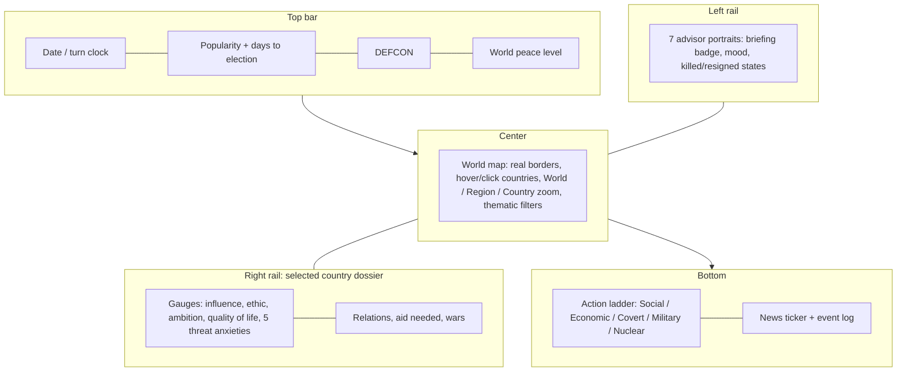

# GTNW UI strategy — "The Situation Room" (October 2026)

GTNW today is a WOPR-terminal game with many systems (DEFCON, 750+ crises, 132 actions, AI opponents, voice
diplomacy) spread across tabs and sheets. Shadow President (1993) did one thing GTNW doesn't: **everything happened on
one screen around a living world map**, and every decision had a face (an advisor) and a consequence you could see
(an animation, a sound, a poll, a city that got better or burned). This strategy keeps GTNW's depth and borrows that
structure.

## Principles
1. **One home screen.** The map is always visible; actions, advisors, dossiers and news are rails and sheets around it,
   not separate tabs. Tabs remain for deep views (Budget, War Room, Factbook, Settings).
2. **Select a country, then act.** Every action starts from a country on the map; the dossier shows what you are about
   to affect and how it feels about you.
3. **Every action has a face and a consequence.** An advisor recommends (approve / caution / oppose, with a reason),
   the action plays an animation and a sound, and the result shows up as a change you can see on the map and gauges.
4. **Escalation is a ladder.** Actions are grouped Social → Economic → Covert → Military → Nuclear, left to right, so
   the player always sees how far up they are climbing (and DEFCON tracks it).
5. **Two skins, one layout.** *Modern* (the current GTNW glass/neon design system) and *Retro* (Shadow President's
   EGA palette and pixel art from the optional local Shadow Pack). A toggle switches between them.
6. **Readable at a glance.** Gauges over numbers; numbers on hover; colour = state (green calm → red crisis).

## New features (from Shadow President's systems, re-implemented in GTNW's own terms)
| Priority | Feature | Why it matters | Notes |
|---|---|---|---|
| 1 | **Real bordered world map** with hover/click, three zoom levels and ~20 thematic filters (GNP, military, nuclear, unrest, alignment, war...) | The map becomes the interface | GeoJSON borders; hit-testing via a country-id raster |
| 2 | **Advisor advice engine** wired to the existing ACCEPT / REJECT buttons; advisors can resign, be fired, be killed or face scandal | Decisions get a voice and a cost | `Advisor.generateAdvice` exists but is never called |
| 3 | **Leader personality per country**: ambition and ethic (1–6) + ideology | AI opponents behave like distinct people | Drives which actions the AI picks |
| 4 | **Five threat anxieties** per country (nuclear, military, political, economic, social) | Richer, legible AI reactions than one hostility number | Shown as dossier gauges; spikes trigger crises |
| 5 | **Popularity, polls, elections** (toggleable), impeachment and assassination endings | Domestic stakes; a reason not to nuke everyone | Ties into existing approval/Congress |
| 6 | **Five-category foreign aid with "need"** (humanitarian, economic, intelligence, military, nuclear) | Buying influence becomes a real decision | Countries react: thanks / partial / reject |
| 7 | **Federal budget** with an end-of-year cycle (taxes, defense, social, research, aid) | Money is the limiting resource | Feeds GNP growth, QoL, military power, aid pool |
| 8 | **World Evaluation**: leadership effectiveness, influence share, QoL, world peace level | Clear sense of "am I winning?" | Always-on mini gauge + globe sheet |
| 9 | **City View** for the selected country, built from tiles that grow with GNP/QoL/military and burn when nuked | Makes consequences physical | Retro tiles from the pack; modern skin can draw its own |
| 10 | **War Room**: troops by front, weekly fighting over neighbouring countries, surrender → new government | Wars become something you manage | `WarRoomView.swift` exists; needs a model |
| 11 | **Scenario loader + save/load slots** incl. a "1990" scenario (Ethiopia–Somalia war, the Iraq timeline) | Replayable setups | Event queue = dated scripted events |
| 12 | **Monthly turn mode** (optional) | Weekly combat and yearly budget fit naturally | Decision for Jordan; yearly stays default |

## Delivered on branch `shadow-pack` (2026-10-16 night)
- `Shared/ShadowPack/ShadowPack.swift` — optional local pack loader (images, GIF animations, WAV sounds) with fallbacks,
  Retro art / Sound toggles (Retro menu, Settings → Shadow Pack).
- Advisor portraits (7 Shadow President posts mapped onto GTNW cabinet titles), War Room title art.
- Action animations + sounds on EXECUTE (espionage, sabotage, surgical strike, assassination, negotiations, aid,
  nuclear threat) and nuclear/victory/crisis cinematic art and sound.
- `tools/build_shadow_pack.py` builds the pack locally; `.gitignore` blocks pack content from the public repo.

## Decisions needed
1. **Turn length:** keep one year per turn, or add a monthly mode (recommended as an option)?
2. **Game text:** the plan writes new advisor/news text in GTNW's voice (recommended for a public repo); the original
   text could optionally load from the local pack for a "classic" feel.
3. **Retro skin scope:** pack art only where it fits (current), or a full EGA-palette Retro skin for the whole UI?

## Known issue found along the way
The **iOS target does not build**: 24 source files that the macOS target compiles (e.g. `HistoricalAdministrations.swift`,
`CinematicEngine.swift`, `WorldCountriesDatabase.swift`) are missing from `GTNW_iOS`, and some use AppKit-only APIs.
Pre-existing; not changed on this branch.
