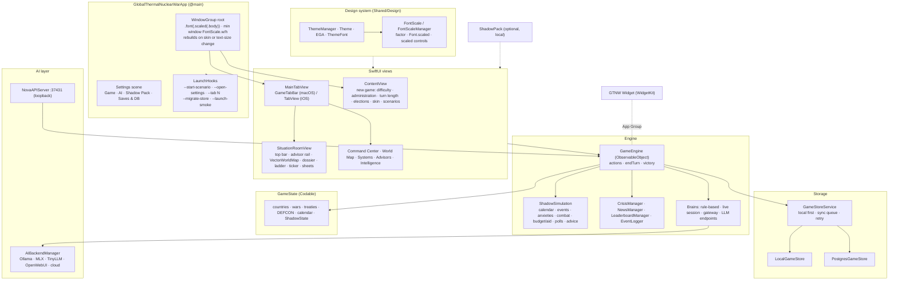
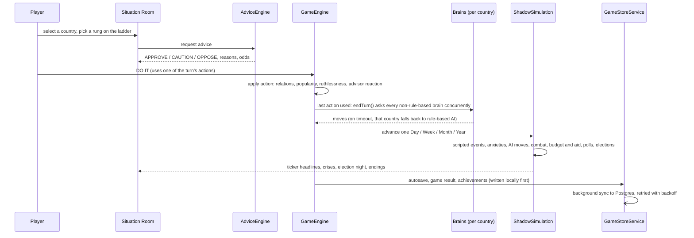
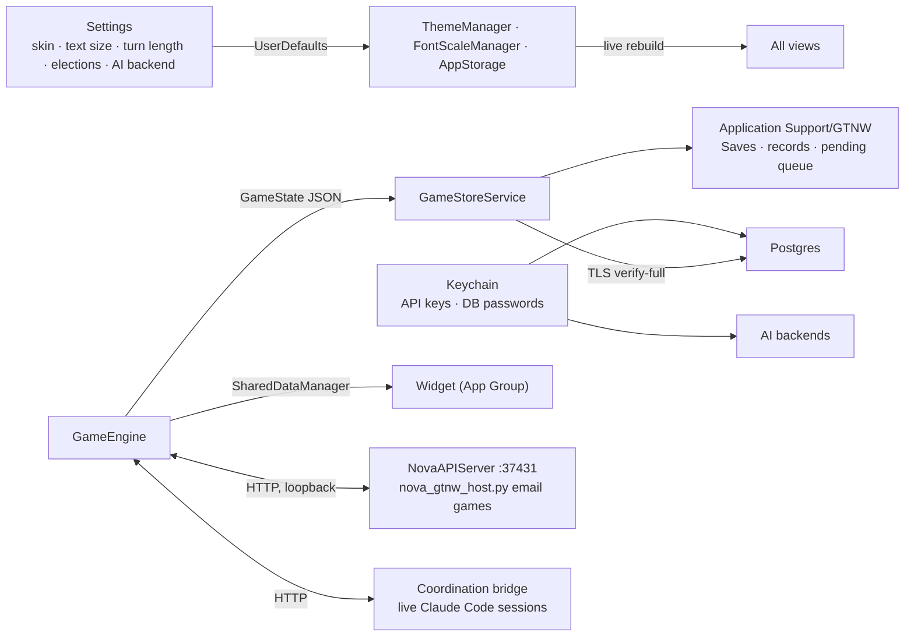
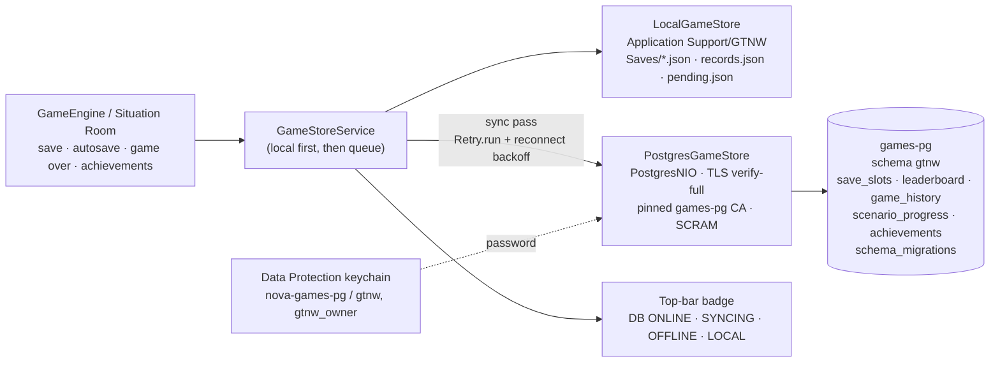

# GTNW: Global Thermal Nuclear War


GTNW is a grand-strategy presidential simulator covering 236 years of American history (1789 to 2025). You play one
of 47 U.S. presidents. You run the country from a Situation Room built around a live world map, handle historical
and generated crises, manage the budget, foreign aid and a nuclear arsenal, and deal with 195 countries whose
leaders have personalities and fears of their own. The question is whether the only winning move really is not to
play.

The game is inspired by the WOPR computer in *WarGames* (1983), and the Situation Room by *Shadow President* (1993).

Written by Jordan Koch.


---

## Contents

- [What's in the game](#whats-in-the-game)
- [Text size and skins](#text-size-and-skins)
- [Architecture](#architecture)
- [Turn and data flow](#turn-and-data-flow)
- [Durable game state: the Games DB](#durable-game-state-the-games-db)
- [Who plays each country: brains](#who-plays-each-country-brains)
- [AI backends](#ai-backends)
- [Local HTTP API and email multiplayer](#local-http-api-and-email-multiplayer)
- [Installation](#installation)
- [How to play](#how-to-play)
- [Source layout](#source-layout)
- [Testing](#testing)
- [Privacy and security](#privacy-and-security)
- [Version history](#version-history)
- [License and credits](#license-and-credits)

---

## What's in the game

### The Situation Room (home screen)

Everything happens on one screen:

- **Top bar**: date, actions left this turn, popularity, days to the next election, DEFCON, world peace level, the
  Games DB status badge, and the Budget, Save/Load and End Turn buttons. When the text is too big for one row, the
  controls wrap onto a second row.
- **Bordered world map** built from Natural Earth outlines (public domain). Hover or click any country. Zoom to
  World, Region or Country, and pick one of 23 map filters: alliances, ideology, wealth, quality of life, ethic,
  ambition, the five worries, aid need, and more.
- **Advisor rail**: seven cabinet posts with names, portraits and briefings.
- **Country dossier**: leadership, quality of life, influence and unrest, the leader's ambition and ethic, the five
  worries, and aid needed by category. City View is opened from here.
- **Escalation ladder** with five rungs: Social, Economic, Covert, Military, Nuclear. Each action carries advice
  and odds.
- **News ticker** and sheets for Budget, Foreign Aid, War Room, World Evaluation, City View, Save/Load and Election
  Night.

### The calendar

- New games start on Inauguration Day of the era year. A scenario can pick a different date.
- A turn is a **Day, Week, Month (the default) or Year**, with 1, 1, 2 or 4 actions.
- All time-based rates scale with elapsed game time: era technology, arms races, crisis odds, program durations,
  cooldowns, DEFCON calm-down and victory thresholds.
- Budgets, the State of the Union and elections fall on their real dates.
- Saves from before 3.0 load as one-year-per-turn games.

### Advisors and advice

- On every action, the seven advisors recommend **APPROVE**, **CAUTION** or **OPPOSE**, and each gives a reason.
- Advisors keep standing proposals, which you can accept, reject, or answer by asking for an alternative.
- An advisor who is overruled too often resigns. Advisors can also be fired, die in attacks, or leave in a scandal.

### World leaders and computer-run countries

- Every leader has ambition and ethic (each rated 1 to 6), an ideology and a leadership score.
- Leaders also carry **five worries**: nuclear, military, political, economic and social. These drive what
  computer-run countries do, and a sharp rise in a worry becomes a crisis.
- **Adaptive opponents** track how you play (aggression, bluffing, alliance preferences, risk tolerance) and adjust
  their strategy to match.

### Domestic politics

- Popularity and polls, plus presidential elections, which can be turned off.
- Impeachment escalates month by month when you are both unpopular and ruthless.
- Assassination risk rises with ruthlessness and very low approval. Extreme unrest at home can end in civil war.
- **Presidential powers**:
  - 10 kinds of executive order
  - 6 kinds of pardon
  - Presidential addresses with cooldowns
  - Cabinet firings, which have knock-on effects on loyalty and approval

### Budget and foreign aid

- **Federal budget**: four taxes and four spending lines on a year-end cycle. It feeds growth, quality of life,
  military strength and the foreign-aid pool.
- **Foreign aid** comes in five categories. Recipients may thank you, join in, or refuse the aid.

### War and peace

- **War Room**: fronts with weekly fighting, morale, and U.S. troop commitments. A country that surrenders gets a
  new government.
- **Military alliances** with era-accurate membership:
  - NATO's Article 5 brings in every member, with members from 1949 up to Sweden in 2024.
  - The Warsaw Pact exists from 1955 to 1991.
  - AUKUS, CSTO, SCO, the Arab League, ASEAN and the African Union give partial collective defense.
- **Nuclear arms race**: a power that falls 40% or more behind builds up at era-appropriate rates. SALT I, START I and
  New START caps bring arsenals down. All nine nuclear states use SIPRI/FAS warhead, ICBM, SLBM and bomber counts.
- **DEFCON** runs from 5 down to 1. Nuclear strikes play cinematic sequences.
- **Other theaters**: cyber warfare, economic warfare, and covert operations.

### History and content

- **47 playable presidents**, Washington through 2025, with about 80 cabinet members, era starting scenarios and
  crisis timelines. All 32 pre-nuclear administrations are fully playable without nuclear weapons.
- **195 countries**: all UN members plus Taiwan, Kosovo and Hong Kong. Each has GDP, population, military and
  nuclear data, and ten categories of CIA World Factbook data that affect gameplay.
- **Era-accurate maps**:
  - The USSR appears only from 1922 to 1991.
  - Germany, Vietnam, Yugoslavia and Czechoslovakia split or merge in their correct years.
  - Colonial-era names are used where they applied, such as the Ottoman Empire, Persia and Siam.
- **Over 750 crises**: more than 290 written by hand (from the Whiskey Rebellion in 1794 to the Ukraine war in 2022),
  with the rest generated during play. A crisis generator adapts them to your actions.
- **Scenarios**: The World in 1990, Thirteen Days (1962), Able Archer (1983) and The World Today.
- **World Evaluation**: a six-band world peace level plus a Presidency Summary.
- **City View**: a city that grows with the economy and burns when it is hit by a nuclear strike.

### AI-driven extras

- **The Living Room**: voice conversations with world leaders, using F5-TTS voice cloning. Leaders remember your tone,
  your promises and your betrayals.
- **Predictive Intelligence**: forecasts of war 3 to 5 turns ahead, the DEFCON trend, likely alliances, crisis timing
  and coup risk.
- **Natural-language intelligence queries**, AI-generated **propaganda** in period style, and a **live news network**.

### Endings

| Victory | Defeat |
|---------|--------|
| Diplomatic: lasting peace treaties | Nuclear war, whether you launch or are hit |
| Domination: sole superpower | DEFCON 1 with no resolution |
| Economic: win the economic war | Losing an election (when elections are on) |
| Peacemaker: 20 game years with no wars and no launches by you | Impeachment |
| Survival: 100 game years through a nuclear winter | Assassination |
| **WOPR ending**: 50 game years with zero wars and zero launches | Civil war |

In the WOPR ending, WOPR takes over and runs 2,005 war scenarios, all ending in "WINNER: NONE". It then gives its
verdict: *"A strange game. The only winning move is not to play."*

### Also included

- **Leaderboard and achievements**, synced through the Games DB.
- **macOS desktop widget** in small, medium and large sizes. It shows DEFCON, war status, the president, the turn and
  a dashboard, shared through the App Group `group.com.jkoch.gtnw`.

---

## Text size and skins

### Text size (new in 3.1.1)

All text in GTNW is drawn through one scale factor, `FontScale.factor`:

| Platform | Default | Steps |
|----------|---------|-------|
| macOS | **2×** | 1×, 1.5×, 2×, 2.5× |
| iOS / iPadOS | 1× (native Dynamic Type is kept) | same |

- **Where to change it:** Settings › Game › Text size. The value is saved in `UserDefaults` (`GTNW.fontScale`)
  alongside the other preferences, and the change applies live because the window rebuilds.
- **How fonts are built:**
  - `Font.scaled(size:weight:design:)` multiplies a fixed size by the factor.
  - `Font.scaled(.caption, design:)` maps a text style to its macOS point size, then multiplies by the factor.
  - The Retro skin's Monaco face goes through `Font.scaledCustom`.
  - Weights and designs are kept in every case.
- **Native controls:** AppKit draws segmented pickers, pop-up menus, checkboxes and the `TabView` strip at a fixed
  size and ignores `.font`. GTNW replaces them with SwiftUI versions that use scaled fonts: `ScaledSegmentedPicker`,
  `ScaledMenuPicker`, `.scaledCheckbox`, and a themed game tab bar on macOS.
- **Layout:**
  - Fixed frames that hold text scale with `FontScale.w`, `FontScale.h` and `FontScale.of`, which are capped to the
    screen size.
  - The minimum window size scales the same way, so 2× content fits.
  - The Situation Room top bar wraps instead of overflowing.
- **Guard test:** a source-scanning test fails the build if any `.font(` call, or any `Font.system`, `Font.custom`,
  `NSFont` or `UIFont` construction, bypasses the scale.

### Skins

- **Modern**: the default look.
- **Retro (EGA)**: the 16-colour EGA palette, a monospaced bitmap-style font and beveled panels.

Switch skins from the Retro menu (⌘⇧R), from Settings › Game, or on the new-game screen. Both skins respect the text
size.

**Optional Shadow Pack.** If you own *Shadow President*, `tools/build_shadow_pack.py` builds a local pack of its art
and sounds. GTNW then uses that pack for portraits, animations, city tiles and sounds. Without it, GTNW falls back to
its own drawn art. The pack is never part of this repository.

---

## Architecture



---

## Turn and data flow





---

## Durable game state: the Games DB

Save slots and the autosave, the leaderboard, game history, scenario progress and achievements are stored in the
dedicated **Nova Games Postgres**: database `games`, schema `gtnw`. This is separate from Nova's own database.
Preferences (skin, text size, sound, window, AI backend) stay in `UserDefaults`.



- **Local first.** Every write goes to the on-device cache and is queued in `pending.json`, so play never waits on
  the network. Each sync pass pushes the queue, then pulls anything newer, such as slots saved on another Mac.
- **Offline.** If the DB can't be reached, the game carries on, writes stay pending, and the service retries with
  backoff.
- **Status badge.** The top bar shows one of four states in both skins:
  - `DB ONLINE`
  - `SYNCING`
  - `OFFLINE · n`, where n is the number of pending writes
  - `LOCAL`, when no DB is configured
- **Concurrent syncs.** Overlapping sync requests share one pass. If a caller joins a pass that started before its
  request and that pass fails, the caller gets one fresh pass of its own rather than the old failure.
- **Schema.** Versioned migrations (`GameStoreMigrations`) run as `gtnw_owner` and are recorded in
  `gtnw.schema_migrations`. They add check constraints (slot range, payload size, score bounds) and indexes. At run
  time the app connects as `gtnw`, which only has DML rights.
- **Security.**
  - TLS is required, verified with `verify-full` against the bundled CA.
  - Every value is passed as a bound parameter.
  - Save payloads are versioned JSON, capped at 8 MiB and validated on load.
  - Passwords are kept only in GTNW's Data Protection keychain.
- **Configuration.** The default server is `192.168.1.5:5433` (TLS name `nova-core3`); you can change it under
  Settings › Saves & DB. That tab also handles one-time credential setup in either of two ways:
  - *Fetch from core3 (SSH)* runs `remote.sh getpw` with `BatchMode`.
  - Paste the output of `deploy/deploy.sh macpw gtnw | pbcopy`.
- **Migration.** On the first run with a DB, the legacy `UserDefaults` leaderboard and achievements and the save files
  are imported once.
  - Before the import, they are backed up to `/Volumes/Data/xcode/GTNW-backups/<timestamp>/`.
  - The import is idempotent and checked by comparing counts.
  - To run it headless: `GTNW.app/Contents/MacOS/GTNW --migrate-store [--setup-credentials]`.

---

## Who plays each country: brains

Each country can be driven by a different **brain**. You assign them in the **BRAINS** panel of the Command Center.

| Brain | What it is |
|-------|------------|
| **Human** | A person at the keyboard. No automated move is made for that country. |
| **Rule-based AI** | The fast built-in AI and the default for every computer-run country. It never uses the network. |
| **This Session (live PvP)** | A live Claude Code session answers that country's moves in real time. |
| **Gateway-Claude (always-on)** | An opponent served by Nova Gateway (`:18792`) that doesn't need a human session. |
| **Local / frontier models** | Any OpenAI-compatible endpoint: local Ollama models (found automatically at `:11434/api/tags`), or frontier models through OpenRouter. |

Only countries with a brain other than rule-based make remote calls, and those calls run concurrently in a
`TaskGroup`. Each call has a timeout: a brain that doesn't answer in time falls back to rule-based AI, so a turn never
blocks.

To reach a live session, GTNW POSTs a `MoveRequest` to `tools/gtnw_coordination_bridge.py`. The bridge stores it in
`nova_ops.claude_coordination` (topic `gtnw-move`). The session writes a `MoveResponse` back, and GTNW polls for it.
The row schema is in `migrations/2026-08-18_gtnw_coordination_moves.sql`.

---

## AI backends

AI generates crises, diplomatic dialogue and opponent behavior. By default it runs locally and needs no internet
connection.

| Backend | Description |
|---------|-------------|
| Ollama | HTTP API on localhost:11434, any model |
| MLX | Python MLX toolkit, native to Apple Silicon |
| TinyLLM / TinyChat | Lightweight local servers |
| OpenWebUI | Self-hosted, localhost:8080 |
| OpenAI, Google, Azure, AWS, IBM Watson | Optional cloud services, with keys stored in the Keychain |
| Auto | Uses the best backend that is available |

Without any backend, GTNW uses a deterministic AI that is still challenging. Every external call goes through
`Shared/Engine/Retry.swift`:

- Network calls get 3 attempts, with backoff of 0.5 s and then 1 s. Subprocesses get 2 attempts.
- Transport errors, 408, 429 and 5xx responses are retried.
- Other 4xx responses fail immediately.

---

## Local HTTP API and email multiplayer

`NovaAPIServer` listens on `127.0.0.1:37431` (loopback only).

```
GET    /api/status | /api/ping | /api/administrations | /api/game/sessions
POST   /api/game/new
GET    /api/game/:id/state | /api/game/:id/crisis
POST   /api/game/:id/crisis/resolve | /api/game/:id/turn | /api/game/:id/action
DELETE /api/game/:id

# Multiplayer (one shared session at a time)
GET  /api/game-state | /api/crises | /api/history
POST /api/start-session | /api/decision | /api/assign-countries
```

`nova_gtnw_host.py` hosts games by email:

1. It assigns countries to players.
2. It emails Markdown crisis briefings each turn.
3. Players reply with a single digit (0 to 3).
4. It posts the results to Slack.

There are two modes. *Live* mode drives the running app through the API. *Simulation* mode works without the app,
using Ollama.

```bash
nova_gtnw_host.py start --year 1962 --scenario "Cuban Missile Crisis"
nova_gtnw_host.py advance | check | status | reset
```

---

## Installation

### DMG (recommended)

1. Download `GTNW-v<version>-build<N>.dmg` from [GitHub Releases](https://github.com/kochj23/GTNW/releases).
2. Open it and drag **GTNW** onto the **Applications** shortcut.
3. (Optional) For AI features, install Ollama and a model: `brew install ollama && ollama pull mistral`.

GTNW isn't on the Mac App Store.

### Build from source

Requires Xcode 15 or later.

```bash
git clone git@github.com:kochj23/GTNW.git
cd GTNW
open GTNW.xcodeproj
```

| Target | Platform |
|--------|----------|
| `GTNW_macOS` | macOS 13 (Ventura) or later, universal. Runs without the app sandbox. |
| `GTNW_iOS` | iOS 15 or later, iPhone and iPad |
| `GTNW Widget` | WidgetKit extension |

| Requirement | Minimum | Recommended |
|-------------|---------|-------------|
| macOS | 13.0 | 14.0 or later |
| iOS | 15.0 | 17.0 or later |
| RAM | 8 GB | 16 GB |
| AI backend | None (deterministic fallback) | Ollama or MLX |

### Launch options (QA and screenshots)

| Flag | Effect |
|------|--------|
| `--start-scenario` | Starts *The World in 1990* immediately |
| `--tab N` | Opens a game tab: 0 Situation Room, 5 Command, 1 Map, 2 Systems, 3 Advisors, 4 Intel |
| `--open-settings` | Opens Settings after launch |
| `--launch-smoke` | Starts hidden, checks that startup works, and exits 0 |
| `--migrate-store` | Runs the legacy-data import headless and prints a JSON report |
| `-GTNW.theme retro`, `-GTNW.fontScale 1.5` | Overrides a preference for this launch only |

---

## How to play

1. On the new-game screen, choose:
   - a difficulty and an administration (any of 47 presidents)
   - a turn length
   - whether elections are on
   - a skin

   Or pick one of the scenarios instead.
2. In the Situation Room, click a country, read its dossier and its leader's worries, and check what your advisors
   say.
3. Climb the escalation ladder only as far as you need to. Each action uses up one of the turn's actions.
4. Manage the budget and foreign aid, commit troops in the War Room, and save from the top bar.
5. Watch DEFCON. At DEFCON 1, nuclear war begins.

---

## Source layout

```
GTNW/
  GTNW.xcodeproj/          Xcode project (macOS, iOS, widget, tests)
  Package.swift            SwiftPM descriptor
  Shared/
    GlobalThermalNuclearWarApp.swift   App entry, Settings scene, LaunchHooks
    Design/                FontScale (text size + scaled controls), Theme (Modern / Retro EGA), ModernDesign
    Engine/                GameEngine, Retry; Shadow/ (calendar, profiles, anxieties, budget, aid,
                           popularity, elections, advice, combat, scenarios, world evaluation, simulation)
    Models/                GameState, Country, crises, advisors, alliances, world DB, factbook, AI backends
    Views/                 Start screen, MainTabView, Command Center, maps, crises, powers, leaderboard
      SituationRoom/       Home screen, VectorWorldMap, advice panel, sheets
    Storage/               GameStore protocol, Postgres / local / in-memory stores, service, migrations, UI
    ShadowPack/            Optional local Shadow President art and sound loader
    AI/ Intelligence/ Diplomacy/ Warfare/ Economics/ Events/ Media/ Cinematics/ Audio/
    Achievements/ Visualization/ Resources/
    NovaAPIServer.swift    Loopback HTTP API
  GTNW/AICapabilities/     Unified AI, voice, image generation, analysis, security
  GTNW Widget/             WidgetKit extension
  GTNWTests/               XCTest suite (all seven categories)
  tools/                   Map converter, Shadow Pack builder, coordination bridge, launch smoke
```

---

## Testing

The suite has **308 tests and 0 failures**, covering all seven required categories. No test touches the network, the
real `UserDefaults`, or real saves.

| Category | Tests | What it covers |
|----------|------:|----------------|
| **Unit** | 140 | Countries, GameState, DEFCON, eras, scoring, victory, Codable, brains and move parsing, calendar, popularity, budget and aid, combat, scenarios, profiles, Shadow Pack loader, themes, Games DB records, **font scale maths, persistence and clamping** |
| **Functional** | 41 | Game lifecycle, war and treaties, nuclear strikes, AI opponents (offline, declaring war), save then load, Games DB flows, **every font path doubles at 2× and the Text size setting persists and applies live** |
| **Security** | 45 | Input bounds, state integrity, serialization, resource abuse, API keys sent only in headers, hostile LLM output, the loopback API, Games DB TLS, parameters and payload caps, **source guard that rejects any unscaled `.font(`, `Font.system`, `Font.custom`, `NSFont` or `UIFont`** |
| **Integration** | 13 | Engine to brain to HTTP to state; live-session post and poll; persistence; Games DB end to end with an in-memory remote |
| **Performance** | 15 | Turn throughput, concurrent brains, timeouts, save/load, bounded logs, a 200-record leaderboard, a 50-item sync |
| **Retry** | 34 | `RetryPolicy` maths and `Retry.run`, `.optional` and `.http`; LLM clients, Ollama, MLX and Games DB sync all retry |
| **Frame** | 20 | The real app as test host, offscreen renders in both skins, launch smoke, store badge; **at 2×: the top bar, Situation Room, leaderboard columns, DB badge, Settings, scaled controls and game tab bar all fit without truncating** |

```bash
xcodebuild -project GTNW.xcodeproj -scheme GTNW_macOS -destination 'platform=macOS' test
tools/launch_smoke.sh /Applications/GTNW.app
```

---

## Privacy and security

- Core gameplay works with no internet connection. Saves sync to the Games DB on the LAN when it can be reached and
  stay local otherwise.
- There is no telemetry or tracking.
- API keys and DB passwords are stored only in the Keychain, never in `UserDefaults`, files or logs.
- The HTTP API listens on loopback only.
- Postgres connections use TLS `verify-full` against a pinned CA.

---

## Version history

| Version | Date | Highlights |
|---------|------|------------|
| 3.1.1 | Oct 2026 | Text size setting (2× default on macOS), every font scaled, crisp scaled controls, layout fixes, zero Release warnings |
| 3.1.0 | Oct 2026 | Games DB: saves, leaderboard, history, scenario progress and achievements in Postgres, offline-first |
| 3.0.0 | Oct 2026 | Situation Room, calendar turns, bordered map, advisors' advice, elections, budget, aid, War Room, scenarios, Retro EGA skin |
| 2.0.0 | May 2026 | Multiplayer API, Nova email game hosting |
| 1.9.0 | May 2026 | XCTest suite, warning fixes |
| 1.8.x | Mar 2026 | Nuclear arsenal accuracy, non-NATO alliances, CIA Factbook |
| 1.6.x | Mar 2026 | All 47 presidents, 195 countries, cabinets, NATO / Warsaw Pact |
| 1.5.1 | Feb 2026 | Desktop widget |
| 1.3.0 | Jan 2026 | Voice-acted leaders, propaganda, Living Room, predictive AI |
| 1.0.0 | 2025 | First release |

See [CHANGELOG.md](CHANGELOG.md) for details.

---

## Content advisory

GTNW simulates nuclear war, political violence, covert operations and historical atrocities, aiming for historical
accuracy. It shows consequences and does not glorify war. It is meant for ages 17 and up and works as a teaching tool
for U.S. history and political science.

---

## License and credits

MIT License, Copyright (c) 2025-2026 Jordan Koch. See [LICENSE](LICENSE).

- **Map outlines:** [Natural Earth](https://www.naturalearthdata.com) 1:50m Admin 0 (public domain), simplified by
  `tools/natural_earth_to_gtnw.py`.
- ***Shadow President*** (D.C. True, 1993) inspired the Situation Room's mechanics. None of its art, sound, text or
  data is in this repository.
- **Voice cloning:** F5-TTS. **Local AI:** Ollama and MLX.
- **Inspired by** *WarGames* (1983), *Civilization* and *DEFCON*.

Written by Jordan Koch ([kochj23](https://github.com/kochj23)).

| More apps | |
|-----|-----|
| [MLXCode](https://github.com/kochj23/MLXCode) | Local AI coding assistant for Apple Silicon |
| [NMAPScanner](https://github.com/kochj23/NMAPScanner) | Network security scanner with AI threat detection |
| [RsyncGUI](https://github.com/kochj23/RsyncGUI) | Rsync front end for macOS |
| [Blompie](https://github.com/kochj23/Blompie) | AI-powered text adventure engine |

*"The only winning move is not to play... but you are going to play anyway."* (WOPR, *WarGames*, 1983)

> Disclaimer: This is a personal project created on the author's own time. It is not affiliated with, endorsed by, or
> representative of any employer.
