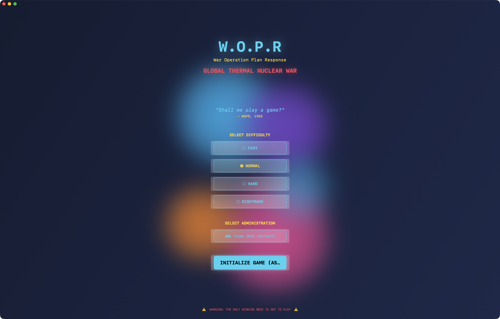
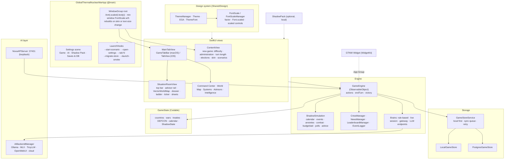
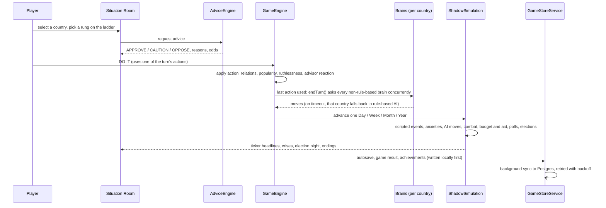
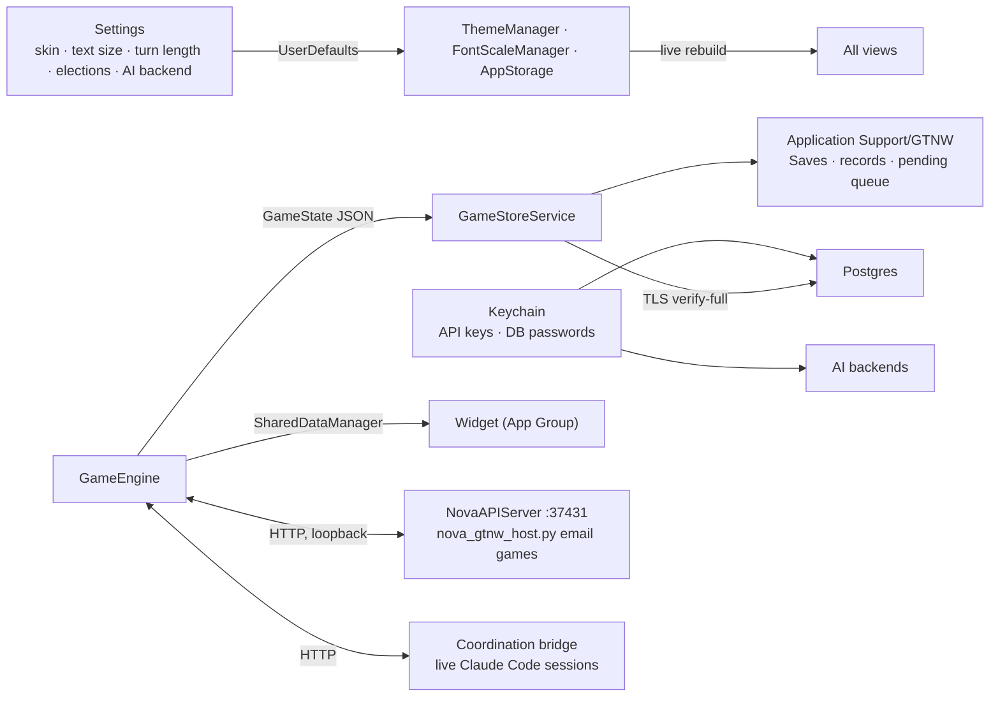
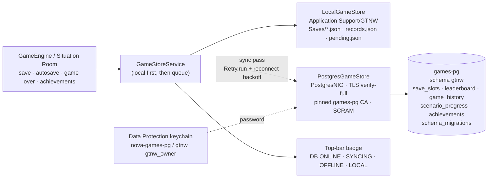

# GTNW: Global Thermal Nuclear War


GTNW is a grand-strategy presidential simulator covering 236 years of American history (1789 to 2025). You play one
of 47 U.S. presidents. You run the country from a Situation Room built around a live world map, handle historical
and generated crises, manage the budget, foreign aid and a nuclear arsenal, and deal with 195 countries whose
leaders have personalities and fears of their own. The question is whether the only winning move really is not to
play.

The game is inspired by the WOPR computer in *WarGames* (1983), and the Situation Room by *Shadow President* (1993).

Written by Jordan Koch.



---

## Contents

- [What's in the game](#whats-in-the-game)
- [Text size and skins](#text-size-and-skins)
- [Architecture](#architecture)
- [Turn and data flow](#turn-and-data-flow)
- [Durable game state: the Games DB](#durable-game-state-the-games-db)
- [Who plays each country: brains](#who-plays-each-country-brains)
- [AI backends](#ai-backends)
- [Local HTTP API and email multiplayer](#local-http-api-and-email-multiplayer)
- [Installation](#installation)
- [How to play](#how-to-play)
- [Source layout](#source-layout)
- [Testing](#testing)
- [Privacy and security](#privacy-and-security)
- [Version history](#version-history)
- [License and credits](#license-and-credits)

---

## What's in the game

### The Situation Room (home screen)

Everything happens on one screen:

- **Top bar**: date, actions left this turn, popularity, days to the next election, DEFCON, world peace level, the
  Games DB status badge, and the Budget, Save/Load and End Turn buttons. When the text is too big for one row, the
  controls wrap onto a second row.
- **Bordered world map** built from Natural Earth outlines (public domain). Hover or click any country. Zoom to
  World, Region or Country, and pick one of 23 map filters: alliances, ideology, wealth, quality of life, ethic,
  ambition, the five worries, aid need, and more.
- **Advisor rail**: seven cabinet posts with names, portraits and briefings.
- **Country dossier**: leadership, quality of life, influence and unrest, the leader's ambition and ethic, the five
  worries, and aid needed by category. City View is opened from here.
- **Escalation ladder** with five rungs: Social, Economic, Covert, Military, Nuclear. Each action carries advice
  and odds.
- **News ticker** and sheets for Budget, Foreign Aid, War Room, World Evaluation, City View, Save/Load and Election
  Night.

### The calendar

- New games start on Inauguration Day of the era year. A scenario can pick a different date.
- A turn is a **Day, Week, Month (the default) or Year**, with 1, 1, 2 or 4 actions.
- All time-based rates scale with elapsed game time: era technology, arms races, crisis odds, program durations,
  cooldowns, DEFCON calm-down and victory thresholds.
- Budgets, the State of the Union and elections fall on their real dates.
- Saves from before 3.0 load as one-year-per-turn games.

### Advisors and advice

- On every action, the seven advisors recommend **APPROVE**, **CAUTION** or **OPPOSE**, and each gives a reason.
- Advisors keep standing proposals, which you can accept, reject, or answer by asking for an alternative.
- An advisor who is overruled too often resigns. Advisors can also be fired, die in attacks, or leave in a scandal.

### World leaders and computer-run countries

- Every leader has ambition and ethic (each rated 1 to 6), an ideology and a leadership score.
- Leaders also carry **five worries**: nuclear, military, political, economic and social. These drive what
  computer-run countries do, and a sharp rise in a worry becomes a crisis.
- **Adaptive opponents** track how you play (aggression, bluffing, alliance preferences, risk tolerance) and adjust
  their strategy to match.

### Domestic politics

- Popularity and polls, plus presidential elections, which can be turned off.
- Impeachment escalates month by month when you are both unpopular and ruthless.
- Assassination risk rises with ruthlessness and very low approval. Extreme unrest at home can end in civil war.
- **Presidential powers**:
  - 10 kinds of executive order
  - 6 kinds of pardon
  - Presidential addresses with cooldowns
  - Cabinet firings, which have knock-on effects on loyalty and approval

### Budget and foreign aid

- **Federal budget**: four taxes and four spending lines on a year-end cycle. It feeds growth, quality of life,
  military strength and the foreign-aid pool.
- **Foreign aid** comes in five categories. Recipients may thank you, join in, or refuse the aid.

### War and peace

- **War Room**: fronts with weekly fighting, morale, and U.S. troop commitments. A country that surrenders to
  another computer-run country gets a government shaped like the victor's.
- **Terms of surrender (new in 3.2.0)**: when a country surrenders to the United States (or to a side the U.S.
  fought for), you decide its future on a WOPR-style *Terms of Surrender* screen, with a one-line take from the
  relevant advisor on every option:
  - **Annex it as a U.S. territory.** The map shows it in U.S. blue under white hatching with a dashed border and a
    `U.S. TERRITORY` tag, under every map filter; the legend has a *Territory* entry and the dossier a badge. Its
    nuclear arsenal is seized into the U.S. stockpile, it joins the U.S. alliance, and it stops acting on its own.
    Occupation has costs: unrest that turns into insurgent attacks (never a change of government), output cut by 30%
    while it is rebuilt, relations with rivals down 20 and with everyone else down 10 (allies 3), and more outrage
    at home.
  - **Let it form a new government of your choosing**: Democratic Republic, Constitutional Monarchy, Military Junta,
    Communist One-Party State, Theocracy, Provisional Government or Client State. Each sets the country's
    government, ideology, camp, stability and relations with Washington (see the table below).
  - The screen can't be dismissed. A choice still open when you end the turn falls back to the pre-3.2 settlement
    (a government shaped like the victor's). Saves keep territories and open choices; older saves load unchanged.

  | New government | Camp | Stability | Relations with U.S. | Notes |
  |---|---|---:|---:|---|
  | Democratic Republic | Western | 45 | +55 | Elections every 8 turns |
  | Constitutional Monarchy | Victor's | 55 | +45 | The steadiest choice |
  | Military Junta | Independent | 25 | +20 | Least stable, ambitious |
  | Communist One-Party State | Eastern | 50 | −20 | Turns toward Moscow |
  | Theocracy | Non-aligned | 40 | −10 | Restless |
  | Provisional Government | Non-aligned | 30 | +35 | Elections in 2 turns |
  | Client State | Victor's | 35 | +85 | Joins the U.S. alliance; resented at home |

  ```mermaid
  flowchart TD
      F[Front resolves: attacker won] --> Q{Did the U.S. attack,<br/>or fight on the winning side?}
      Q -- no --> V[Victor installs a government<br/>shaped like its own]
      Q -- yes --> P[ShadowState.pendingSettlements<br/>Terms of Surrender sheet]
      P --> A[Annex as U.S. territory]
      P --> G[Choose the new government<br/>7 types]
      P -. still open at next turn .-> V
      A --> M[Map: U.S. colour + hatching + U.S. TERRITORY tag<br/>arsenal seized, insurgency, world reaction]
      G --> N[Government, ideology, camp,<br/>stability and relations set]
  ```
- **Territory money (new in 3.13.1)**: what your territories earn now lands in your **spendable funds** (the same
  pot as aid, group actions and colony purchases) every turn, with a "Territories paid $X B this month." ticker line;
  a quarter of it also shows in national output. From the **Resources** panel (or a **group action** on all
  territories):
  - **Extraction rate** per territory: Light (×0.6 income), Normal, Heavy (×1.5; insurgency +12, stability −1/month,
    world opinion −1/year) or Plunder (×2.5; insurgency +30, stability −3/month, world −4/year, and a 25%/year
    revolt once unrest passes 60).
  - **Collect**: a one-off levy of half a year's income (at least $0.2B) for −10 stability and +10 unrest, then six
    months' cooldown.
  - The panel shows this turn's cash and your funds, each land's $/yr or "producing in N months", and what limits it
    (low garrison or low stability) with the fix.
  - **First-year recovery (3.13.2)**: new land starts at 40–50 stability, short of the 60 full output needs. Held with
    an adequate garrison under Light or Normal extraction, it climbs to 60 by its first anniversary, and the panel
    says so: "Stability 45 → 60 in ~8 months at this garrison." Countdowns use calendar months.

  ```mermaid
  flowchart LR
      T[Territory] --> R{Extraction rate}
      R -- Light/Normal --> I[Income]
      R -- Heavy/Plunder --> I
      R -- Heavy/Plunder --> U[Insurgency up, stability down,<br/>world opinion down]
      U -- plunder, unrest > 60 --> X[Revolt: the land breaks away]
      T -- Collect --> L[Levy: ½ year's income now<br/>−10 stability, 6-month cooldown]
      T -- first year, garrison OK,<br/>Light/Normal --> Y[Stability climbs to 60<br/>by the anniversary]
      Y --> I
      I --> F[Spendable funds + ticker line]
      L --> F
      I --> O[¼ to national output]
      F --> S[Aid, group actions, purchases]
  ```
- **Takeable land on every continent (new in 3.13.0)**: before a modern country existed, its land is no longer
  blank. About a hundred dated records (`Documentation/territories/`, generator `build.py` →
  `TerritoryData.swift`) say who held it:
  - **Colonies** of an era power in the game (New Spain and the Captaincy General of Guatemala under Spain, British
    North America, Russian America, Portuguese Brazil, the viceroyalties of New Granada, Peru and the Río de la
    Plata, the Caribbean colonies, the Australian colonies, French Indochina, British Malaya, Chosen under Japan, the
    Ottoman provinces of the Middle East and the Balkans, Ireland, Congress Poland, the Grand Duchy of Finland and
    more) are drawn in the owner's colour under a hatch with a "New Spain (Spain)" label. **Seize** one by force
    (sized troops against the colonial garrison, or an amphibious fleet; it means war with the owner, and coalitions
    work against the owner), **buy** it (price from its value and relations; never in wartime), or **back its
    independence** (likelier near the real date): it becomes an allied state.
  - **Land held by peoples the game doesn't model as states** (Aotearoa before 1840, New Guinea, the Konbaung
    kingdom, the Malay and Gulf sheikhdoms, the Arabian emirates, the Polish–Lithuanian Commonwealth after 1789) is
    shown as such. Its people resist: taking it needs enough troops, leaves an unstable territory with an
    insurgency, and after 1945 draws condemnation.
  - **Historical U.S. purchases** appear as offers in their real windows: Louisiana (1803, $15 million), Florida
    (Adams–Onís, 1819), the Gadsden Purchase (1853), Alaska (1867, $7.2 million; Alaska is now its own outline) and
    the Danish West Indies (1917). Louisiana, Florida and Gadsden lie inside today's U.S. outline, so they add
    resources and score rather than a shape.
  - Anything taken is an ordinary territory: name it, govern it, earn from it, and petition for statehood. Africa
    keeps its 3.3.0 rules.

  ```mermaid
  flowchart TD
      L[Land whose country doesn't exist yet] --> K{Who holds it? TerritoryData}
      K -- era power --> C[Colony: owner's colour, hatched]
      K -- peoples not modelled as a state --> I[Indigenous land]
      C --> S[Seize: troops vs garrison · war with owner]
      C --> B[Buy: price from value and relations]
      C --> F[Back independence: allied state]
      O[Historical offers in their windows<br/>Louisiana 1803 · Florida 1819 · Gadsden 1853 · Alaska 1867 · Danish West Indies 1917] --> T
      I --> R[Take by force: resistance, unrest,<br/>condemnation after 1945]
      S --> T[U.S. territory: name, govern, statehood]
      B --> T
      R --> T
  ```
- **Evolving cabinets (new in 3.12.2)**: officeholders change on their real dates while the game still matches
  history (Bevin hands the Foreign Office to Morrison in March 1951). The player's own government follows history
  only until the player's choices diverge: making an appointment, winning an election, or history recording someone
  else in the player's office (the game keeps you in it). Computer-run nations show their historical leader of the day
  on the dossier until their own story diverges (a change of government, annexation or destruction).
- **The Gulf War, 1990 (new in 3.12.2)**: a scenario starting on invasion day, 2 Aug 1990, scored against
  history: Congress's authorization (12 Jan 1991), the 35-nation coalition, Desert Storm, Kuwait liberated
  (28 Feb 1991), no nuclear use. Thirteen Days (1962) now also scores the naval quarantine (24 Oct 1962) and DEFCON 2.
- **Allied coalitions (new in 3.12.0)**: **Coalition** on a dossier asks the era's treaty allies (NATO from 1949, the
  Warsaw Pact…), alliances made in play and friendly nations (a coalition of the willing) to join an operation
  against that country, one action for all. Each decides by its relations with you, its ties to the target and the
  legitimacy of the action: a legislative authorization or a real casus belli helps, chemical or biological weapons
  drive allies away. Members send a tenth of their forces to the front and **share the world's reaction**; those who
  refuse cool a little. The sheet shows each nation's odds from the same formula.
- **Historical scenarios (new in 3.12.0)**: Day of Infamy (7 Dec 1941), the Berlin Blockade (24 Jun 1948), Korea
  (25 Jun 1950) and September 11, 2001 join Thirteen Days (1962), Able Archer (1983), the World in 1990 and the World
  Today, each with a historically set board and dated events. Each has a **scorecard** (top-bar **Scorecard**) that
  compares your game with what actually happened (e.g. "The U.S. fights Germany: Yes, 11 Dec 1941 / this game: No"),
  encyclopedia-level facts only.

  ```mermaid
  flowchart LR
      T[Target] --> C[Coalition candidates:<br/>treaty allies · in-play allies · friends]
      C --> O[Odds: relations, ties to the target,<br/>authorization, casus belli, banned weapons]
      O -- join --> J[Troops to the front<br/>world reaction shared 1/(n+1)]
      O -- refuse --> R[Relations −5]
      S[Historical scenario] --> B[Board + dated events] --> SC[Scorecard: history vs this game]
  ```
- **Play as other nations (new in 3.11.0)**: **Nation** on the start screen picks any nation that exists in the
  start year (★ = real cabinet data). The cabinet is the nation's real officeholders on the start date, from bundled
  research covering 33 nations and about 13,000 officeholders (`Documentation/cabinets/`; `gen_compact.py` builds
  `Shared/Resources/nation_cabinets.json`), with each office's own title. Where the record has a gap the slot shows the
  generic title for that form of government and "(no record)": names are never invented. Uncertain records carry a
  "?", and dates after April 2026 keep the last earlier holder marked "(acting/unverified)". You play the prime minister
  in parliamentary systems, the party leader in communist states, otherwise the head of state. How you fall follows
  the government of the day: a **no-confidence vote**, a **coup**, a **revolution**, a **party congress**, a **junta
  decision** or **royal dismissal**, each with its own warnings; U.S. impeachment applies only to the U.S. The
  U.S.-only systems (Congress and the War Powers clock, U.S. elections, the draft, statehood, named U.S. fleets) are
  hidden or refused for other nations, and the computer runs the United States. Play history records the nation and
  its leader ("country_name", "leader").

  ```mermaid
  flowchart TD
      N[Start screen: nation + start year] --> C{Cabinet data for the nation?}
      C -- yes --> R[Real holders on the date<br/>? uncertain · acting/unverified after Apr 2026]
      C -- gap or none --> G[Generic titles for the government type<br/>no invented names]
      R & G --> P[Play: U.S.-only systems hidden; the AI runs the U.S.]
      P --> M{Pressure at the monthly poll}
      M -- U.S. --> I[Impeachment → Senate trial]
      M -- others --> X[No-confidence · coup · revolution ·<br/>party congress · junta · royal dismissal]
  ```
- **Antarctica (new in 3.10.0)**: the continent is on both map styles (and the card grid) and can be claimed in any
  era. Before the Antarctic Treaty it is open land with seven overlapping national claims shown on its dossier
  (United Kingdom 1908, New Zealand 1923, France 1924, Australia 1933, Norway 1939, Chile 1940, Argentina 1943),
  none sovereign. Between signing (1 Dec 1959) and entry into force (23 Jun 1961) a claim is restricted; after that
  it **violates the treaty** and costs like any treaty-banned option (world and allies furious, sanctions,
  impeachment hearings). It needs only a 0.5K garrison, but the cold takes 5% of it a month and upkeep is heavy. It
  yields sealing (to 1900), whaling (to 1964), science prestige (from 1957), and minerals and oil only from 2048, when
  the Madrid Protocol's mining ban can be reviewed.
- **Group actions (new in 3.10.0)**: **Group** in the top bar acts on many nations at once: all U.S. territories,
  all allies (the era's treaty allies plus alliances made in play), all of a region, a hand-picked set, or a saved
  custom group. Give money or send aid (split evenly or by need), set garrisons, impose sanctions, send a diplomatic
  message or recall ambassadors. One confirmation shows the total and the per-nation breakdown. Each nation goes
  through the same single-nation code as before (identical effects and logging), the group costs one action
  (garrison changes are free), and play history gets one `group_action` event listing the members.

  ```mermaid
  flowchart LR
      S[Pick: territories · allies · region · hand-picked · saved] --> A[Action + amount + split]
      A --> P[Plan: per-nation breakdown and total]
      P --> C{Confirm}
      C --> E[Each member through the single-nation code<br/>sendAid · setGarrison · presidential action]
      E --> L[One action · one group_action event]
  ```
- **Occupation and statehood (new in 3.9.0)**: **Govern** on a U.S. territory's dossier sets its **garrison**
  (drawn from the troop pool; it needs about 2K per √million people), its **government** (military governor, local
  elections or self-rule; self-rule calms it most but keeps 40% of the wealth at home) and shows its **insurgency**
  and stability, which drift each turn toward targets set by those choices. A territory left boiling over for a year
  with too few troops **breaks away**. One held five years, stable (60+), quiet (insurgency 30 or less) and with two
  years of elected government can **petition for statehood**; Congress votes, and it joins as the 49th, 50th or 51st
  state (counted from the real admissions of its era), keeping its player-given name and adding a star ("U.S. STATE
  ★51" on the map). Statehood scores +1000. Annexations now come with an occupation garrison.
- **Draft and mobilization (new in 3.9.0)**: U.S. troops are finite and era-based: the standing army and Guard of
  the day (20K in 1850, 200K in 1913, about 1.1M today) plus draftees while a historical draft is in force (Civil War
  1863–65, 1917–18, 1940–47, 1948–73; trained over six months). After 1973 the force is all-volunteer; **Troops** in
  the top bar opens Manpower, where the President can **call a draft** (+500K or more over six months; approval −8,
  Congress −5, less in wartime) or **mobilize the reserves** (+30% in a month). Invasions, expeditions, garrisons and
  troops sent to the War Room all draw on this pool, so you can't send troops you don't have.
- **Also in 3.9.0**: computer-run countries size their own attacks with the 3.4.0 model (aggressive ones go in
  overwhelming, cautious ones probe, already-dominant ones hold back); the World Map card grid shows unclaimed land
  (claim and name it there too) and a Rename button on U.S. territory cards.

  ```mermaid
  flowchart TD
      M[Manpower: standing force of the era<br/>+ historical or called draft] --> F[Free troops]
      F --> S[Sizing, expeditions, War Room]
      F --> G[Garrisons]
      G --> O[Occupation each turn:<br/>insurgency and stability drift]
      V[Government: governor / elections / self-rule] --> O
      O -- boiling a year, too few troops --> L[Breaks away]
      O -- 5 years, stable, quiet, elected --> P[Petition Congress]
      P -- pass --> ST[Statehood: the Nth state, a new star, +1000 score]
  ```
- **Congress and the war powers (new in 3.8.0)**: the top bar shows Congress's support **by chamber** (the House
  follows the public more, the Senate less) and any **War Powers clock**. **Congress** on a dossier asks for a
  *Declaration of War* or an *Authorization for Use of Military Force* (one action). Both chambers vote, with odds from
  their support, the public's war support and the casus belli (the target attacked us, struck us with nuclear weapons,
  is at war with an ally, or is plainly hostile); an authorization is easier than a declaration. A pass rallies the
  country; a rebuff costs approval and support. From the **War Powers Resolution (7 Nov 1973)**, hostilities the U.S.
  starts or joins without authorization start a 60-day clock, with warnings at 45 and 60 days, then 30 days to
  withdraw; defying it costs Congress's support and adds outrage. Congress's support drifts monthly with approval and
  outrage. **Impeachment** is a visible process (inquiry → articles → House vote → Senate trial) and ends in a
  **Senate trial that needs two-thirds to convict**; an acquittal ends it. Party control isn't modelled.
- **Advisor warnings (new in 3.8.0)**: before any major action (invasion, air strike, bombardment, blockade, nuclear
  strike, chemical or biological weapon, annexation, land claim, fleet order) the **Joint Chiefs**, the **Secretary of
  State** and the **Vice President** each give one line, from the same numbers the engine uses: odds and losses,
  the world's reaction and treaties, approval, the War Powers clock and impeachment pressure. Overrule (proceed) or
  cancel. *Settings → Advisor warnings* turns them off.

  ```mermaid
  flowchart TD
      A[Major action] --> W{Advisor warnings on?}
      W -- yes --> L[Joint Chiefs · Secretary of State · Vice President<br/>odds, losses, world, approval, Congress]
      L --> O{Overrule or cancel}
      W -- no --> X[Act]
      O -- overrule --> X
      X --> H{Hostilities after Nov 1973<br/>without authorization?}
      H -- yes --> C[War Powers clock: 60 days + 30 to withdraw<br/>warnings at 45 and 60]
      C -- defied --> P[Congress support −15, outrage +15]
      Q[Ask Congress: declaration / AUMF] --> V{House and Senate vote}
      V -- pass --> K[Authorized: clock cleared, rally]
      V -- fail --> F[Approval −3, support −5]
      P --> I[Impeachment: inquiry → articles → House vote → Senate trial, ⅔ to convict]
  ```
- **Territory wealth and the politics of expansion (new in 3.7.0)**: taking land now pays, and is priced fairly.
  - **Resources**: every territory, claimed or annexed, yields era-accurate resources from roughly when they were first
    exploited (`ExpansionModel.deposits`): South African diamonds (1867) and gold (1886), Gold Coast gold and cocoa
    (1890s), Copperbelt copper (c.1928), Congo ivory and rubber (to c.1914–20), copper, diamonds, cobalt and uranium
    (1940s), Nigerian (1956) and Libyan (1959) oil, Niger uranium (1971), Egyptian and Sudanese cotton, Moroccan
    phosphates, and so on; lands without a table entry farm a little. Income starts six months after taking a land,
    reaches full output at two years, and scales with stability and garrison. It adds to U.S. output and approval
    (prosperity, up to +5) and is listed per territory in the **Resources** panel. "Gotit is now producing copper"
    goes on the ticker and into play history.
  - **Strategic resources**, in their eras: oil (from 1910) fuels a 15% larger air arm and 10% faster fleets, uranium
    (from 1942) adds about 20 warheads a year, and rubber keeps a 10% larger army moving in the world wars.
  - **Score**: +100 per territory held, +10 per $1B of resources earned (+1000 per statehood, for when that arrives).
  - **Politics by era** (`ExpansionModel.politics`): before 1919 a few claims a year are popular (+0.5 approval each
    up to six), then anti-imperialist backlash grows; the outrage per claim is 0.5 + 0.003 × (n − 4)², so a handful is
    cheap and dozens a year are dangerous. Interwar claims cost more; after 1945 every annexation costs approval and
    outrage, and the world reacts three times as hard. World-opinion hits grow with the spree too.
  - **No surprise impeachment**: the top bar shows **impeachment risk** (the pressure Congress acts on at each monthly
    poll) and the **approval floor** (38%); the Chief of Staff warns on the dossier before a claim that would tip it;
    the ticker warns the turn pressure crosses the line; and the "articles drafted" stage says the House votes at the
    next poll unless approval recovers.
  - Rebalance check: replaying the 3.3.0 session that ended in removal (1913, 27 claims of 5K troops over 8 weeks)
    now ends with approval in the low 40s and no impeachment stage at all; 47 claims in a week still brings hearings.

  ```mermaid
  flowchart TD
      C[Claim or annex a land] --> P[ExpansionModel.politics<br/>era × claims this year]
      P -- few, pre-1919 --> U[Approval +0.5, little outrage]
      P -- spree or post-1945 --> D[Outrage ∝ n², world reaction ×]
      C --> R[Resources by era<br/>ramp-up 6 months → 2 years]
      R --> I[Income × stability × garrison]
      I --> G[U.S. output, prosperity approval,<br/>score, Resources panel]
      I --> S[Strategic: oil, uranium, rubber]
      D --> K{Impeachment pressure > 12?}
      K -- yes --> W[Risk badge HIGH, Chief of Staff warns,<br/>ticker warns before the poll]
      W --> V[Monthly poll: Congress advances one stage]
  ```
- **Era weapons catalog (new in 3.6.0)**: every attack option the United States actually had, by year, from a
  bundled table of 47 options (`ArsenalCatalog`, generated from the research in `Documentation/arsenal/`). Under each
  action the sheet shows the era's arsenal (e.g. *ARSENAL 1918: Infantry · Field artillery · Horse cavalry · Armor*)
  and, for anything restricted or banned, its status and treaty. Nothing nuclear appears before Trinity (16 Jul 1945).
  - **Chemical and biological weapons** are new attack options on the Military rung. They're labelled, never hidden,
    and priced by legal status (design choices): a pre-treaty era such as 1917–18 costs little abroad; the restricted
    years (Geneva Protocol, signed 1925, ratified 1975) cost more; **treaty-banned** use (Chemical Weapons Convention
    1997, Biological Weapons Convention 1975) costs every relationship, allies doubly, brings sanctions on U.S. output
    and opens impeachment hearings.
  - **Destroyed stockpiles can't be used off the shelf**: chemical after 7 Jul 2023, biological after 1969 (the
    program ran 1943–1969). The President must first **restart the program** (Covert rung): 2 years for chemical,
    3 for biological, with a 35% a year chance of discovery before it is ready, which carries the same treaty-banned
    penalties. INF-range ground missiles (1988–2019) are labelled treaty-banned too.
  - Encyclopedia level only: names, dates, game effects and diplomatic consequences.

  ```mermaid
  flowchart TD
      D[Date] --> C{ArsenalCatalog}
      C -- before the option existed --> H[Hidden: e.g. no nukes before 16 Jul 1945,<br/>no chemical before 1917]
      C -- stockpile exists --> L{Legal status}
      C -- stockpile destroyed --> R[Restart the program<br/>2–3 years, 35%/yr discovery risk]
      R -- ready --> L
      R -- discovered --> P
      L -- legal, e.g. 1918 --> S[Small opinion cost]
      L -- restricted --> M[Moderate cost]
      L -- treaty-banned --> P[World and allies furious, sanctions,<br/>impeachment hearings open]
  ```
- **Naval operations (new in 3.5.0)**: "Send the Fifth Fleet to Japan!" **Fleet** on a country's dossier (and **Fleet
  orders** on unclaimed coastal land) opens the fleet-order sheet: pick a **named U.S. fleet of the era**, a mission and
  how much of the fleet to commit (Probe 25% / Standard 50% / Overwhelming 100%, the 3.4.0 sizing step).
  - **Fleets by era** (`NavalModel.fleets`, from `Documentation/arsenal`): no U.S. navy until 1797 and no named
    squadron before the Mediterranean Squadron (1801); the distant-station squadrons (Pacific, West India, Brazil, East
    India, Home, Africa), the Union blockading squadrons, the European, North Atlantic and Asiatic squadrons, the
    Flying Squadron (1898), the Great White Fleet (1907–09), the Atlantic and first Pacific Fleets, the U.S. Fleet of
    the treaty years, then the Pacific and Atlantic Fleets (1941–) and the numbered fleets with their real gaps and home
    ports (Fifth Fleet 1944–47 and from 1995 in Bahrain; Second Fleet 1950–2011 and from 2018; Seventh Fleet at
    Yokosuka). Ship counts are era-typical: sail and steam surface ships, submarines from 1900, carriers from 1922,
    amphibious ships from 1942. No carriers in 1850.
  - **Missions**: *show of force* (pressure and tension, not war), *blockade* (war; the target's output falls every
    turn on station), *naval strike* (war; damage and casualties with the era's weapon, e.g. Tomahawks only from
    1983), *amphibious invasion* (opens a front with the landing force, or takes unclaimed coastal land outright).
  - **Transit** takes great-circle distance ÷ era speed (sail 150, steam 350, modern 900 km a day) in game days; the
    fleet is drawn on the map with a dashed wake in both skins. On arrival the target's navy and air force engage it:
    up to a quarter of its ships lost, by the defender's share of combined strength. A fleet on station ties up its
    ships until recalled. **Landlocked targets can't be reached** and the sheet says why.

  ```mermaid
  flowchart LR
      O[Fleet orders: fleet of the era,<br/>mission, commitment] --> G{fleetOrderProblem}
      G -- landlocked / not in era / already out / no actions --> X[Refused with the reason]
      G -- ok --> U[Under way: days = km ÷ era speed<br/>map marker + wake]
      U -- arrives --> E[Engagement: ships lost<br/>by defender's share]
      E --> M{Mission}
      M --> S[Show of force: relations, anxiety]
      M --> B[Blockade: war, output falls each turn]
      M --> K[Strike: war, damage, casualties]
      M --> A[Amphibious: front opens,<br/>or unclaimed land claimed]
      S & B & K & A --> T[On station until recalled<br/>play events fleet_ordered / fleet_action]
  ```
- **Size your offensives (new in 3.4.0)**: before a ground invasion, air strike, bombardment or nuclear strike, the
  action sheet shows a **Force size** step: Probe / Standard / Overwhelming presets plus a slider per force the attack
  uses (ground troops in thousands, aircraft sorties, warheads), bounded by what the U.S. has free right now and by the
  era (no aircraft before 1914, no warheads before 1945). A read-out shows the honest consequences from the engine's own
  formulas. **Standard is exactly the pre-3.4 attack** (3 / 5 / 10 warheads by action, the War Room's opening force of
  35% of the force pool, a fifth of the air arm). Expeditions to unclaimed land are sized in troops alone (5K standard;
  1K is enough, and the force stays on as the garrison).

  | Effect | Rule (m = chosen ÷ standard) |
  |---|---|
  | Success odds | min(1, √m): only an undersized attack can fail |
  | Target's relations | the action's usual change × (0.75 + 0.25 m) |
  | Rest of the world | −round(4 × (m − 1)) relations, ruthlessness +round(5 × (m − 1)), for m > 1 |
  | Escalation | m ≥ 2 raises DEFCON one more step |
  | Ground troops | the new front opens with the chosen troops; the War Room then fights it (more troops: better odds, more casualties both ways); they are tied up until it ends |
  | Air | aircraft lost = sorties × 4% × enemy strength, out of the air arm for the rest of the game; a bigger raid kills 5% × (m − 1) of the enemy's front line |
  | Nuclear | the chosen warheads go to the existing strike: damage, radiation, casualties, and retaliation up to twice as many |

  ```mermaid
  flowchart LR
      A[Pick an offensive] --> K{AttackSizing.kinds}
      K -- none --> X[Unsized action<br/>as before]
      K -- troops / aircraft / warheads --> S[Force size step<br/>Probe · Standard · Overwhelming · sliders]
      S --> B[Bounded by free forces<br/>and the era]
      B --> E[executeShadowPresidentAction<br/>size → m]
      E --> O[Odds, relations, world reaction,<br/>DEFCON, fronts, losses]
      E --> P[play event attack_ordered<br/>e.g. 12 warheads]
  ```
  Computer-run countries still attack at their fixed sizes.
- **Unclaimed lands (new in 3.3.0)**: start in an era before a country existed (Africa before ~1960, Libya before
  1951, South Africa before 1910) and its land is on the map as **unclaimed**: parchment on the modern map, light gray
  on the EGA map, under every filter, with an `UNCLAIMED` tag and an *Unclaimed* legend swatch. Click it for a short
  dossier ("Unclaimed land — no government, no army") and a **Send expedition** button. With nobody to fight, the land
  is taken at once as a U.S. territory (drawn exactly like an annexed one) for one action and a small hit abroad
  (rivals −5, others −2, allies none; from 3.7.0 the outrage depends on era and pace, see below). A naming sheet then opens, prefilled with the land's modern name.
  - **Name or rename any U.S. territory**: the dossier of every U.S. territory, claimed or annexed, has **Rename**,
    and the annex option on the Terms of Surrender screen takes an optional new name. Names are trimmed, 1–40
    characters on one line (no control characters), and are always shown as plain text.
  - Only lands that **no era country covers** count: Soviet republics under the Russian Empire or USSR, the Yugoslav
    and Czechoslovak states, Germany, Korea and so on are never unclaimed. Computer-run countries never claim land,
    and unclaimed land never takes a turn. The rule is a small table, `WorldCountriesDatabase.unclaimedLands`.
  - Nothing new is saved: unclaimed land is derived from the start year minus what has been claimed, and a claimed
    land is an ordinary territory, so older saves load unchanged.

  ```mermaid
  flowchart TD
      Y[Game starts in year Y] --> U{Land in unclaimedLands<br/>for Y, not yet a country?}
      U -- no --> C[Ordinary country<br/>or era predecessor]
      U -- yes --> M[Map: parchment / light gray<br/>UNCLAIMED tag, selectable]
      M --> D[Dossier: no government, no army]
      D --> E[Send expedition<br/>1 action, small world-opinion hit]
      E --> T[New U.S. territory<br/>territoryOf = USA]
      S[Terms of Surrender: annex<br/>optional new name] --> T
      T --> N[Naming sheet: 1–40 chars, one line]
      T --> R[Dossier: Rename]
      R --> N
      N --> L[Map, dossier and ticker show the name<br/>play events claimed_land / renamed_territory]
  ```
- **Military alliances** with era-accurate membership:
  - NATO's Article 5 brings in every member, with members from 1949 up to Sweden in 2024.
  - The Warsaw Pact exists from 1955 to 1991.
  - AUKUS, CSTO, SCO, the Arab League, ASEAN and the African Union give partial collective defense.
- **Nuclear arms race**: a power that falls 40% or more behind builds up at era-appropriate rates. SALT I, START I and
  New START caps bring arsenals down. All nine nuclear states use SIPRI/FAS warhead, ICBM, SLBM and bomber counts.
- **DEFCON** runs from 5 down to 1. Nuclear strikes play cinematic sequences.
- **Other theaters**: cyber warfare, economic warfare, and covert operations.

### History and content

- **47 playable presidents**, Washington through 2025, with about 80 cabinet members, era starting scenarios and
  crisis timelines. All 32 pre-nuclear administrations are fully playable without nuclear weapons.
- **195 countries**: all UN members plus Taiwan, Kosovo and Hong Kong. Each has GDP, population, military and
  nuclear data, and ten categories of CIA World Factbook data that affect gameplay.
- **Era-accurate maps**:
  - The USSR appears only from 1922 to 1991.
  - Germany, Vietnam, Yugoslavia and Czechoslovakia split or merge in their correct years.
  - Colonial-era names are used where they applied, such as the Ottoman Empire, Persia and Siam.
- **Over 750 crises**: more than 290 written by hand (from the Whiskey Rebellion in 1794 to the Ukraine war in 2022),
  with the rest generated during play. A crisis generator adapts them to your actions.
- **Scenarios**: The World in 1990, Thirteen Days (1962), Able Archer (1983) and The World Today.
- **World Evaluation**: a six-band world peace level plus a Presidency Summary.
- **City View**: a city that grows with the economy and burns when it is hit by a nuclear strike.

### AI-driven extras

- **The Living Room**: voice conversations with world leaders, using F5-TTS voice cloning. Leaders remember your tone,
  your promises and your betrayals.
- **Predictive Intelligence**: forecasts of war 3 to 5 turns ahead, the DEFCON trend, likely alliances, crisis timing
  and coup risk.
- **Natural-language intelligence queries**, AI-generated **propaganda** in period style, and a **live news network**.

### Endings

| Victory | Defeat |
|---------|--------|
| Diplomatic: lasting peace treaties | Nuclear war, whether you launch or are hit |
| Domination: sole superpower | DEFCON 1 with no resolution |
| Economic: win the economic war | Losing an election (when elections are on) |
| Peacemaker: 20 game years with no wars and no launches by you | Impeachment |
| Survival: 100 game years through a nuclear winter | Assassination |
| **WOPR ending**: 50 game years with zero wars and zero launches | Civil war |

In the WOPR ending, WOPR takes over and runs 2,005 war scenarios, all ending in "WINNER: NONE". It then gives its
verdict: *"A strange game. The only winning move is not to play."*

### Also included

- **Leaderboard and achievements**, synced through the Games DB.
- **macOS desktop widget** in small, medium and large sizes. It shows DEFCON, war status, the president, the turn and
  a dashboard, shared through the App Group `group.com.jkoch.gtnw`.

---

## Text size and skins

### Text size (new in 3.1.1)

All text in GTNW is drawn through one scale factor, `FontScale.factor`:

| Platform | Default | Steps |
|----------|---------|-------|
| macOS | **2×** | 1×, 1.5×, 2×, 2.5× |
| iOS / iPadOS | 1× (native Dynamic Type is kept) | same |

- **Where to change it:** Settings › Game › Text size. The value is saved in `UserDefaults` (`GTNW.fontScale`)
  alongside the other preferences, and the change applies live because the window rebuilds.
- **How fonts are built:**
  - `Font.scaled(size:weight:design:)` multiplies a fixed size by the factor.
  - `Font.scaled(.caption, design:)` maps a text style to its macOS point size, then multiplies by the factor.
  - The Retro skin's Monaco face goes through `Font.scaledCustom`.
  - Weights and designs are kept in every case.
- **Native controls:** AppKit draws segmented pickers, pop-up menus, checkboxes and the `TabView` strip at a fixed
  size and ignores `.font`. GTNW replaces them with SwiftUI versions that use scaled fonts: `ScaledSegmentedPicker`,
  `ScaledMenuPicker`, `.scaledCheckbox`, and a themed game tab bar on macOS.
- **Layout:**
  - Fixed frames that hold text scale with `FontScale.w`, `FontScale.h` and `FontScale.of`, which are capped to the
    screen size.
  - The minimum window size scales the same way, so 2× content fits.
  - The Situation Room top bar wraps instead of overflowing.
- **Guard test:** a source-scanning test fails the build if any `.font(` call, or any `Font.system`, `Font.custom`,
  `NSFont` or `UIFont` construction, bypasses the scale.

### Skins

- **Modern**: the default look.
- **Retro (EGA)**: the 16-colour EGA palette, a monospaced bitmap-style font and beveled panels.

Switch skins from the Retro menu (⌘⇧R), from Settings › Game, or on the new-game screen. Both skins respect the text
size.

**Optional Shadow Pack.** If you own *Shadow President*, `tools/build_shadow_pack.py` builds a local pack of its art
and sounds. GTNW then uses that pack for portraits, animations, city tiles and sounds. Without it, GTNW falls back to
its own drawn art. The pack is never part of this repository.

---

## Architecture



---

## Turn and data flow





---

## Durable game state: the Games DB

Save slots and the autosave, the leaderboard, game history, scenario progress and achievements are stored in the
dedicated **Nova Games Postgres**: database `games`, schema `gtnw`. This is separate from Nova's own database.
Preferences (skin, text size, sound, window, AI backend) stay in `UserDefaults`.



- **Local first.** Every write goes to the on-device cache and is queued in `pending.json`, so play never waits on
  the network. Each sync pass pushes the queue, then pulls anything newer, such as slots saved on another Mac.
- **Offline.** If the DB can't be reached, the game carries on, writes stay pending, and the service retries with
  backoff.
- **Status badge.** The top bar shows one of four states in both skins:
  - `DB ONLINE`
  - `SYNCING`
  - `OFFLINE · n`, where n is the number of pending writes
  - `LOCAL`, when no DB is configured
- **Concurrent syncs.** Overlapping sync requests share one pass. If a caller joins a pass that started before its
  request and that pass fails, the caller gets one fresh pass of its own rather than the old failure.
- **Schema.** Versioned migrations (`GameStoreMigrations`) run as `gtnw_owner` and are recorded in
  `gtnw.schema_migrations`. They add check constraints (slot range, payload size, score bounds) and indexes. At run
  time the app connects as `gtnw`, which only has DML rights.
- **Security.**
  - TLS is required, verified with `verify-full` against the bundled CA.
  - Every value is passed as a bound parameter.
  - Save payloads are versioned JSON, capped at 8 MiB and validated on load.
  - Passwords are kept only in GTNW's Data Protection keychain.
- **Configuration.** The default server is `192.168.1.5:5433` (TLS name `nova-core3`); you can change it under
  Settings › Saves & DB. That tab also handles one-time credential setup in either of two ways:
  - *Fetch from core3 (SSH)* runs `remote.sh getpw` with `BatchMode`.
  - Paste the output of `deploy/deploy.sh macpw gtnw | pbcopy`.
- **Migration.** On the first run with a DB, the legacy `UserDefaults` leaderboard and achievements and the save files
  are imported once.
  - Before the import, they are backed up to `/Volumes/Data/xcode/GTNW-backups/<timestamp>/`.
  - The import is idempotent and checked by comparing counts.
  - To run it headless: `GTNW.app/Contents/MacOS/GTNW --migrate-store [--setup-credentials]`.

---

## Who plays each country: brains

Each country can be driven by a different **brain**. You assign them in the **BRAINS** panel of the Command Center.

| Brain | What it is |
|-------|------------|
| **Human** | A person at the keyboard. No automated move is made for that country. |
| **Rule-based AI** | The fast built-in AI and the default for every computer-run country. It never uses the network. |
| **This Session (live PvP)** | A live Claude Code session answers that country's moves in real time. |
| **Gateway-Claude (always-on)** | An opponent served by Nova Gateway (`:18792`) that doesn't need a human session. |
| **Local / frontier models** | Any OpenAI-compatible endpoint: local Ollama models (found automatically at `:11434/api/tags`), or frontier models through OpenRouter. |

Only countries with a brain other than rule-based make remote calls, and those calls run concurrently in a
`TaskGroup`. Each call has a timeout: a brain that doesn't answer in time falls back to rule-based AI, so a turn never
blocks.

To reach a live session, GTNW POSTs a `MoveRequest` to `tools/gtnw_coordination_bridge.py`. The bridge stores it in
`nova_ops.claude_coordination` (topic `gtnw-move`). The session writes a `MoveResponse` back, and GTNW polls for it.
The row schema is in `migrations/2026-08-18_gtnw_coordination_moves.sql`.

---

## AI backends

AI generates crises, diplomatic dialogue and opponent behavior. By default it runs locally and needs no internet
connection.

| Backend | Description |
|---------|-------------|
| Ollama | HTTP API on localhost:11434, any model |
| MLX | Python MLX toolkit, native to Apple Silicon |
| TinyLLM / TinyChat | Lightweight local servers |
| OpenWebUI | Self-hosted, localhost:8080 |
| OpenAI, Google, Azure, AWS, IBM Watson | Optional cloud services, with keys stored in the Keychain |
| Auto | Uses the best backend that is available |

Without any backend, GTNW uses a deterministic AI that is still challenging. Every external call goes through
`Shared/Engine/Retry.swift`:

- Network calls get 3 attempts, with backoff of 0.5 s and then 1 s. Subprocesses get 2 attempts.
- Transport errors, 408, 429 and 5xx responses are retried.
- Other 4xx responses fail immediately.

---

## Local HTTP API and email multiplayer

`NovaAPIServer` listens on `127.0.0.1:37431` (loopback only).

```
GET    /api/status | /api/ping | /api/administrations | /api/game/sessions
POST   /api/game/new
GET    /api/game/:id/state | /api/game/:id/crisis
POST   /api/game/:id/crisis/resolve | /api/game/:id/turn | /api/game/:id/action
DELETE /api/game/:id

# Multiplayer (one shared session at a time)
GET  /api/game-state | /api/crises | /api/history
POST /api/start-session | /api/decision | /api/assign-countries
```

`nova_gtnw_host.py` hosts games by email:

1. It assigns countries to players.
2. It emails Markdown crisis briefings each turn.
3. Players reply with a single digit (0 to 3).
4. It posts the results to Slack.

There are two modes. *Live* mode drives the running app through the API. *Simulation* mode works without the app,
using Ollama.

```bash
nova_gtnw_host.py start --year 1962 --scenario "Cuban Missile Crisis"
nova_gtnw_host.py advance | check | status | reset
```

---

## Installation

### DMG (recommended)

1. Download `GTNW-v<version>-build<N>.dmg` from [GitHub Releases](https://github.com/kochj23/GTNW/releases).
2. Open it and drag **GTNW** onto the **Applications** shortcut.
3. (Optional) For AI features, install Ollama and a model: `brew install ollama && ollama pull mistral`.

GTNW isn't on the Mac App Store.

### Build from source

Requires Xcode 15 or later.

```bash
git clone git@github.com:kochj23/GTNW.git
cd GTNW
open GTNW.xcodeproj
```

| Target | Platform |
|--------|----------|
| `GTNW_macOS` | macOS 13 (Ventura) or later, universal. Runs without the app sandbox. |
| `GTNW_iOS` | iOS 15 or later, iPhone and iPad |
| `GTNW Widget` | WidgetKit extension |

| Requirement | Minimum | Recommended |
|-------------|---------|-------------|
| macOS | 13.0 | 14.0 or later |
| iOS | 15.0 | 17.0 or later |
| RAM | 8 GB | 16 GB |
| AI backend | None (deterministic fallback) | Ollama or MLX |

### Launch options (QA and screenshots)

| Flag | Effect |
|------|--------|
| `--start-scenario` | Starts *The World in 1990* immediately |
| `--tab N` | Opens a game tab: 0 Situation Room, 5 Command, 1 Map, 2 Systems, 3 Advisors, 4 Intel |
| `--open-settings` | Opens Settings after launch |
| `--launch-smoke` | Starts hidden, checks that startup works, and exits 0 |
| `--migrate-store` | Runs the legacy-data import headless and prints a JSON report |
| `-GTNW.theme retro`, `-GTNW.fontScale 1.5` | Overrides a preference for this launch only |

---

## How to play

1. On the new-game screen, choose:
   - a difficulty and an administration (any of 47 presidents)
   - a turn length
   - whether elections are on
   - a skin

   Or pick one of the scenarios instead.
2. In the Situation Room, click a country, read its dossier and its leader's worries, and check what your advisors
   say.
3. Climb the escalation ladder only as far as you need to. Each action uses up one of the turn's actions.
4. Manage the budget and foreign aid, commit troops in the War Room, and save from the top bar.
5. Watch DEFCON. At DEFCON 1, nuclear war begins.

---

## Source layout

```
GTNW/
  GTNW.xcodeproj/          Xcode project (macOS, iOS, widget, tests)
  Package.swift            SwiftPM descriptor
  Shared/
    GlobalThermalNuclearWarApp.swift   App entry, Settings scene, LaunchHooks
    Design/                FontScale (text size + scaled controls), Theme (Modern / Retro EGA), ModernDesign
    Engine/                GameEngine, Retry; Shadow/ (calendar, profiles, anxieties, budget, aid,
                           popularity, elections, advice, combat, scenarios, world evaluation, simulation)
    Models/                GameState, Country, crises, advisors, alliances, world DB, factbook, AI backends
    Views/                 Start screen, MainTabView, Command Center, maps, crises, powers, leaderboard
      SituationRoom/       Home screen, VectorWorldMap, advice panel, sheets
    Storage/               GameStore protocol, Postgres / local / in-memory stores, service, migrations, UI
    ShadowPack/            Optional local Shadow President art and sound loader
    AI/ Intelligence/ Diplomacy/ Warfare/ Economics/ Events/ Media/ Cinematics/ Audio/
    Achievements/ Visualization/ Resources/
    NovaAPIServer.swift    Loopback HTTP API
  GTNW/AICapabilities/     Unified AI, voice, image generation, analysis, security
  GTNW Widget/             WidgetKit extension
  GTNWTests/               XCTest suite (all seven categories)
  tools/                   Map converter, Shadow Pack builder, coordination bridge, launch smoke
```

### Play history (schema `play`, new in 3.1.2)

Every sitting is logged to the shared `play` schema in the same Games DB (`play.sessions` + `play.events`, see
NovaGames `deploy/db/play.sql`), so Nova's game reporter can write about what was played. Rows are `game='gtnw'`,
`client='mac'`, `player` = the store's player id, written as role `gtnw` (row-level security keeps it to its own rows).

| When | What is written |
|------|-----------------|
| New game or scenario | A new session id (kept on the game as `shadow.playSessionID` / `playSessionStartedAt`), the session row, event `game_start` |
| Loading a save to continue | A **new** session (started now) whose summary has `resumed_from_turn` |
| End of every turn | Events `ticker` (new ticker items with severity ≥ 2) and `nuclear_strike` (new strikes); upsert of `last_seen_at`, `actions` (turns this session) and a running summary |
| Levies (3.13.1) | Event `territory_levy` (`land`, `name`, `amount_b`) |
| Land (3.13.0) | Events `colony_seized`, `land_purchased`, `independence_backed`, and `claimed_land` with `indigenous` |
| Coalitions (3.12.0) | Event `coalition_request` (`target`, `joined`, `refused`) |
| Any game (3.11.0) | `game_start` and the session summary add `country_name`; the summary adds `leader` for non-U.S. nations |
| Group actions (3.10.0) | Event `group_action` (`action`, `group`, `members`, `member_names`, `total`) |
| Manpower and territories (3.9.0) | Events `draft_called`, `mobilization_called`, `statehood` (`land`, `name`, `number`), `territory_lost` |
| Congress (3.8.0) | Events `congress_vote` (`target`, `kind`, `passed`, `house_yes`, `senate_yes`, `odds`) and `war_powers_violation` |
| Territory starts producing (3.7.0) | Event `territory_producing` (`land`, `name`, `resources`, `income_b`) |
| Chemical / biological (3.6.0) | Events `wmd_used` (`kind`, `target`, `legal_status`, `treaty`), `wmd_program_started`, `wmd_program_discovered` |
| Fleet orders (3.5.0) | Events `fleet_ordered` (`fleet`, `target`, `mission`, `preset`, `ships`, `transit_days`), `fleet_action` on arrival (`sentence` such as "Fifth Fleet blockaded Japan", `ships_lost`) and `fleet_recalled` |
| Ordering a sized offensive (3.4.0) | Event `attack_ordered` (`action`, `target`, `target_name`, `troops` / `aircraft` / `warheads`, `aircraft_lost`, `scale`, `success`, `summary` such as "12 warheads") |
| Claiming land / renaming a territory (3.3.0) | Event `claimed_land` (`land`, `name`, `game_date`) or `renamed_territory` (`land`, `old_name`, `name`, `game_date`) at once |
| Game over | Event `game_over`; final upsert with `ended_at`, `outcome` (`victory`/`defeat`), `score` and the full summary. The `gtnw.game_history` row uses the session id, so they join (`history_id`) |
| Starting another game mid-game / quitting the app | The open session is closed as `abandoned` / `quit` (best effort; otherwise the reader's 30-minute idle rule ends it) |

The summary uses the contract's GTNW keys (scenario, country, difficulty, turn length, dates, turns, won, victory type,
reason, scores, casualties, strikes, wars, covert ops, DEFCON, radiation, impeachment, terms, popularity start/peak/end,
congressional and war support, polls ≤ 60, strikes ≤ 60, fronts, aid, budget, ticker ≤ 60, war log ≤ 40) and is
kept under 64 KB. It all goes through the same offline-first queue: logging never blocks a turn, waits while the DB
is down, and a row the DB rejects (or a missing `play` grant) is dropped instead of holding up saves. Without a
Games DB (tests, `LOCAL`), nothing is queued.

---

## Testing

The suite has **526 tests and 0 failures**, covering all seven required categories. No test touches the network, the
real `UserDefaults`, or real saves.

| Category | Tests | What it covers |
|----------|------:|----------------|
| **Unit** | 184 | Countries, GameState, DEFCON, eras, scoring, victory, Codable, brains and move parsing, calendar, popularity, budget and aid, combat, scenarios, profiles, Shadow Pack loader, themes, Games DB records, font scale maths, persistence and clamping, **play-session id round trip, play.sql-mirroring validation, summary keys and caps** |
| **Functional** | 105 | Game lifecycle, war and treaties, nuclear strikes, AI opponents (offline, declaring war), save then load, Games DB flows, every font path doubles at 2× and the Text size setting persists and applies live, **new game / scenario / load each start a play session; game_history id = session id** |
| **Security** | 66 | Input bounds, state integrity, serialization, resource abuse, API keys sent only in headers, hostile LLM output, the loopback API, Games DB TLS, parameters and payload caps, source guard that rejects any unscaled `.font(`, `Font.system`, `Font.custom`, `NSFont` or `UIFont`, **hostile ticker text and NaN in play history, oversized events never queued, test host writes no play rows** |
| **Integration** | 36 | Engine to brain to HTTP to state; live-session post and poll; persistence; Games DB end to end with an in-memory remote; **a played turn's ticker/strike events and actions reach `play`, upserts stay ahead of their events, ended sessions are frozen** |
| **Performance** | 33 | Turn throughput, concurrent brains, timeouts, save/load, bounded logs, a 200-record leaderboard, a 50-item sync, **a big game's summary under 64 KB, a full queue sheds play events first** |
| **Retry** | 58 | `RetryPolicy` maths and `Retry.run`, `.optional` and `.http`; LLM clients, Ollama, MLX and Games DB sync all retry; **play history waits offline, rejected rows are dropped, a missing `play` schema never blocks game writes** |
| **Frame** | 39 | The real app as test host, offscreen renders in both skins, launch smoke, store badge; at 2×: the top bar, Situation Room, leaderboard columns, DB badge, Settings, scaled controls and game tab bar all fit without truncating; **badge counts queued play history, a game runs with no store** |

Test runs are silent and stay off the desktop (3.12.1): the app mutes every audio path when `GTNW_MUTE=1`, when
launched with `-GTNWMute YES`, or whenever it is an XCTest host, and under XCTest it never activates or shows a
window. The scheme's test action sets `GTNW_MUTE=1`.

```bash
TEST_RUNNER_GTNW_MUTE=1 xcodebuild -project GTNW.xcodeproj -scheme GTNW_macOS -destination 'platform=macOS' test
tools/launch_smoke.sh /Applications/GTNW.app
```

---

## Privacy and security

- Core gameplay works with no internet connection. Saves sync to the Games DB on the LAN when it can be reached and
  stay local otherwise.
- There is no telemetry or tracking.
- API keys and DB passwords are stored only in the Keychain, never in `UserDefaults`, files or logs.
- The HTTP API listens on loopback only.
- Postgres connections use TLS `verify-full` against a pinned CA.

---

## Version history

| Version | Date | Highlights |
|---------|------|------------|
| 3.13.2 | Oct 2026 | Levy cooldown is exactly six months; well-run new territories recover to 60 stability in their first year |
| 3.13.1 | Oct 2026 | Territory money: cash into your funds every turn, extraction rates, levies, a Resources panel that says what's holding each land back |
| 3.13.0 | Oct 2026 | Takeable land on every continent: colonies to seize, buy or free, peoples' land to take at a cost, historical U.S. purchases |
| 3.12.2 | Oct 2026 | Evolving cabinets that follow history until you diverge; the Gulf War 1990 scenario; Cuba scorecard adds the quarantine and DEFCON 2 |
| 3.12.1 | Oct 2026 | Mute switch: silent, hidden test runs (GTNW_MUTE, -GTNWMute YES, XCTest host) |
| 3.12.0 | Oct 2026 | Allied coalitions that share the blame; Pearl Harbor, Berlin 1948, Korea 1950 and 9/11 scenarios with history scorecards |
| 3.11.0 | Oct 2026 | Play as any nation of the era with its real cabinet; leaders fall by no-confidence, coup, revolution or party congress; the AI runs the U.S. |
| 3.10.0 | Oct 2026 | Antarctica can be claimed (treaty rules by date, its own map shape); group actions on many nations at once |
| 3.9.0 | Oct 2026 | Govern territories (garrison, insurgency, elections) up to statehood; finite era manpower with drafts and mobilization; the AI sizes its attacks |
| 3.8.0 | Oct 2026 | Congress by chamber, war votes, the War Powers clock, a Senate trial for impeachment, and cabinet warnings before major actions |
| 3.7.0 | Oct 2026 | "No fair!" fixed: territories yield era-accurate resources and score, expansion politics by era and pace, visible impeachment risk with warnings |
| 3.6.0 | Oct 2026 | Era weapons catalog: every U.S. attack option by year, with legal status; chemical and biological weapons priced by treaty, restart-only once destroyed |
| 3.5.0 | Oct 2026 | Naval operations: order named fleets of the era (Fifth Fleet, Great White Fleet, Asiatic Squadron…) on shows of force, blockades, strikes and amphibious landings, with transit, engagements and map markers |
| 3.4.0 | Oct 2026 | Size your offensives: troops, aircraft and warheads with Probe / Standard / Overwhelming presets that change odds, losses, world reaction and escalation |
| 3.3.0 | Oct 2026 | Unclaimed lands: claim land no country held in your era (e.g. 1800s Africa) and name it; rename any U.S. territory |
| 3.2.0 | Oct 2026 | Terms of surrender: annex a vanquished country as a U.S. territory (shown on the map) or choose its new government |
| 3.1.3 | Oct 2026 | Fix: no more End Turn crash when a random crisis has no eligible country left late in a game |
| 3.1.2 | Oct 2026 | Play history: every sitting logged to the shared `play` schema for Nova's game reporter |
| 3.1.1 | Oct 2026 | Text size setting (2× default on macOS), every font scaled, crisp scaled controls, layout fixes, zero Release warnings |
| 3.1.0 | Oct 2026 | Games DB: saves, leaderboard, history, scenario progress and achievements in Postgres, offline-first |
| 3.0.0 | Oct 2026 | Situation Room, calendar turns, bordered map, advisors' advice, elections, budget, aid, War Room, scenarios, Retro EGA skin |
| 2.0.0 | May 2026 | Multiplayer API, Nova email game hosting |
| 1.9.0 | May 2026 | XCTest suite, warning fixes |
| 1.8.x | Mar 2026 | Nuclear arsenal accuracy, non-NATO alliances, CIA Factbook |
| 1.6.x | Mar 2026 | All 47 presidents, 195 countries, cabinets, NATO / Warsaw Pact |
| 1.5.1 | Feb 2026 | Desktop widget |
| 1.3.0 | Jan 2026 | Voice-acted leaders, propaganda, Living Room, predictive AI |
| 1.0.0 | 2025 | First release |

See [CHANGELOG.md](CHANGELOG.md) for details.

---

## Content advisory

GTNW simulates nuclear war, political violence, covert operations and historical atrocities, aiming for historical
accuracy. It shows consequences and does not glorify war. It is meant for ages 17 and up and works as a teaching tool
for U.S. history and political science.

---

## License and credits

MIT License, Copyright (c) 2025-2026 Jordan Koch. See [LICENSE](LICENSE).

- **Map outlines:** [Natural Earth](https://www.naturalearthdata.com) 1:50m Admin 0 (public domain), simplified by
  `tools/natural_earth_to_gtnw.py`.
- ***Shadow President*** (D.C. True, 1993) inspired the Situation Room's mechanics. None of its art, sound, text or
  data is in this repository.
- **Voice cloning:** F5-TTS. **Local AI:** Ollama and MLX.
- **Inspired by** *WarGames* (1983), *Civilization* and *DEFCON*.

Written by Jordan Koch ([kochj23](https://github.com/kochj23)).

| More apps | |
|-----|-----|
| [MLXCode](https://github.com/kochj23/MLXCode) | Local AI coding assistant for Apple Silicon |
| [NMAPScanner](https://github.com/kochj23/NMAPScanner) | Network security scanner with AI threat detection |
| [RsyncGUI](https://github.com/kochj23/RsyncGUI) | Rsync front end for macOS |
| [Blompie](https://github.com/kochj23/Blompie) | AI-powered text adventure engine |

*"The only winning move is not to play... but you are going to play anyway."* (WOPR, *WarGames*, 1983)

> Disclaimer: This is a personal project created on the author's own time. It is not affiliated with, endorsed by, or
> representative of any employer.
